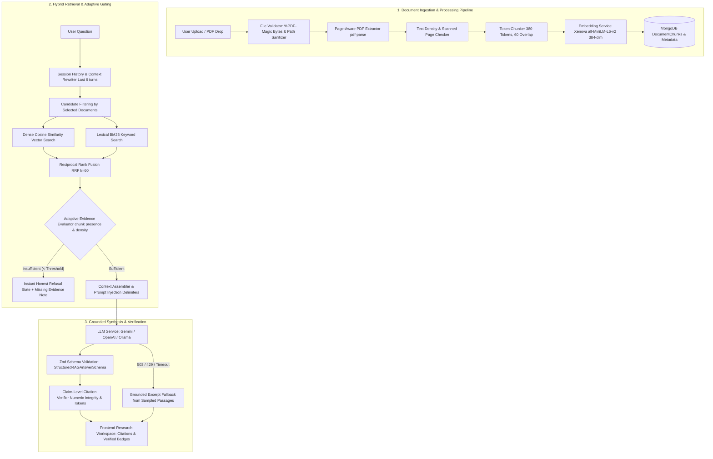

# Multi-Document Research Assistant

> Production-ready AI web application for multi-document academic research, dense & lexical hybrid vector retrieval (RAG), citation-grounded evidence verification, and cross-document comparative analysis across 10 academic dimensions.

[](LICENSE)
[](https://www.typescriptlang.org/)
[](https://nodejs.org/)
[](https://www.mongodb.com/)
[](https://react.dev/)
[](https://tailwindcss.com/)
[](https://vitest.dev/)

---

## 1. Project Overview & Architecture

The **Multi-Document Research Assistant** is engineered to enable students, researchers, professors, and professionals to query, cross-analyze, and synthesize findings across multiple research papers and technical documents simultaneously.

All extracted passages maintain strict page-level and section-level attribution. Incoming questions undergo query reformulation, dense vector search (`all-MiniLM-L6-v2`) combined with BM25-style lexical keyword retrieval, Reciprocal Rank Fusion (RRF), adaptive threshold gating, structured JSON response generation via Google Gemini, and claim-level citation verification with numeric integrity validation.



---

## 2. Key Features

### Research Workspace & Multi-Document Chat
- **Contextual Dialogue & Query Reformulation**: Query rewriting incorporates the previous 6 conversation messages (both user and assistant turns) to resolve pronoun references and follow-up inquiries accurately.
- **Collapsible Research History Drawer**: Access, switch, and delete past research sessions. Switching sessions automatically restores the active conversation history as well as the exact selected document context (`selectedDocumentIds`).
- **Duplicate Message Prevention**: Prevents duplicate user message entries on double submissions or streaming retries.

### Claim-Level Citation Verification & Page Navigation
- **Interactive Citation Cards**: Displays the exact document title, page number, verified badge, and source excerpt for every answer claim.
- **In-App PDF Viewer**: Clicking **"Page X"** opens the built-in PDF viewer modal scrolled directly to the referenced page (`#page=X`).
- **Strict Numeric Integrity**: Flags any cited excerpt where key numbers, metrics, or percentages do not match the generated claim.

### 10-Dimension Cross-Document Comparison
Compares multiple documents across all 10 academic and analytical dimensions:
1. **Research Objectives**
2. **Methodologies**
3. **Models and Technologies**
4. **Datasets**
5. **Evaluation Metrics**
6. **Results**
7. **Advantages**
8. **Limitations**
9. **Conclusions**
10. **Research Gaps**
- **Sticky Header Column**: Responsive layout keeps the `Evaluation Dimension` column sticky on mobile and tablet devices while scrolling across papers.
- **Honest Missing Data**: Dimensions unaddressed in a paper are marked clearly as `"Not reported in document"` rather than fabricated.
- **Full Markdown Export**: One-click download of the complete comparative matrix as an academic `.md` table.

### Honest Document Summaries
- **Zero Hallucinated Fallbacks**: Removed all generic boilerplate summaries. When extraction or AI synthesis fails, an honest error banner with a "Retry Synthesis" action is displayed.
- **Interactive Summary Regeneration**: Allows regenerating summaries directly from updated chunk passages.
- **Quantitative Metrics & Findings**: Renders overview, key takeaways, and quantitative findings with page-jump references.

### Reliability & Security Hardening
- **Safe Document Reprocessing**: Staged chunk replacement ensures existing working chunks and embeddings remain completely intact if re-indexing encounters an error.
- **Cascade Deletion**: Removing a document cleanly deletes its associated chunks, removes its ID from research sessions, and unlinks physical files without leaving orphaned records.
- **Error Sanitization**: Centralized error middleware strips absolute Windows/Linux file paths, stack traces, and API keys before sending responses to clients.
- **In-Memory Rate Limiting**: Built-in sliding-window rate limiters prevent API exhaustion for expensive AI endpoints (HTTP 429).

---

## 3. Technology Stack

| Layer | Technologies |
| :--- | :--- |
| **Frontend** | React 19, TypeScript 5.7, Vite 8, Tailwind CSS 3.4, Lucide Icons, Axios |
| **Backend** | Node.js 20+, Express 4.21, TypeScript 5.7, Mongoose 8.9, Multer, Zod 3.24 |
| **AI / NLP** | `@google/genai` (Gemini 2.5/3.5/Flash-Lite), `@xenova/transformers` (local `all-MiniLM-L6-v2`), OpenAI API, Ollama |
| **Database** | MongoDB 6.0+ (Local Community Edition or MongoDB Atlas) |
| **Testing** | Vitest 3.2 (Backend), Vitest 5.1 + Testing Library (Frontend), ESLint, Oxlint |

---

## 4. Prerequisites (Windows 11 / macOS / Linux)

1. **Node.js**: Version $\ge 20.0.0$ ([Download Node.js LTS](https://nodejs.org/))
2. **npm**: Version $\ge 10.0.0$ (bundled with Node.js)
3. **MongoDB**: Version $\ge 6.0$ installed locally or a remote MongoDB Atlas URI.
   - For Windows 11, MongoDB Community Edition is located typically at:
     `C:\Program Files\MongoDB\Server\<version>\bin\mongod.exe`

---

## 5. Local Installation & Setup

### Step 1: Clone Repository
```bash
git clone https://github.com/Dhanashri1010/Multi-Document-Research-Assistant.git
cd Multi-Document-Research-Assistant
git checkout improvements
```

### Step 2: Install Dependencies
```bash
# Install backend dependencies
npm --prefix backend install

# Install frontend dependencies
npm --prefix frontend install
```

### Step 3: Configure Environment Variables
Copy `.env.example` in `backend/` to `backend/.env`:
```bash
# Windows PowerShell
Copy-Item backend/.env.example backend/.env

# Linux / macOS
cp backend/.env.example backend/.env
```

Review and configure your `backend/.env` file:
```env
PORT=5000
FRONTEND_URL=http://localhost:5173
MONGODB_URI=mongodb://127.0.0.1:27017/multi_doc_research
UPLOAD_DIR=./uploads
MAX_FILE_SIZE_MB=25

# Embedding Settings
EMBEDDING_PROVIDER=local
EMBEDDING_MODEL=all-MiniLM-L6-v2
VECTOR_SEARCH_PROVIDER=local

# Generative LLM Settings
LLM_PROVIDER=gemini
LLM_MODEL=gemini-3.1-flash-lite
LLM_API_KEY=YOUR_GEMINI_API_KEY_HERE

# RAG & Gating Settings
CHUNK_TARGET_TOKENS=380
CHUNK_OVERLAP_TOKENS=60
PRE_LLM_COSINE_THRESHOLD=0.28
COMPARE_TIMEOUT_MS=30000
```

---

## 6. How to Run the Application (Windows 11)

### Terminal 1: Start MongoDB Daemon
If MongoDB is not running as a Windows Service, launch it in a dedicated terminal:
```powershell
& "C:\Program Files\MongoDB\Server\8.2\bin\mongod.exe" --dbpath "e:\Multi document Research Assistant\.mongodb_data"
```

### Terminal 2: Start Backend Development Server
```powershell
npm --prefix backend run dev
```
The backend initializes database connection and begins listening on `http://localhost:5000`.

### Terminal 3: Start Frontend Development Server
```powershell
npm --prefix frontend run dev
```
Open [http://localhost:5173](http://localhost:5173) in your browser.

---

## 7. How to Run Automated Tests

### Run Complete Test Suite
```bash
# Run all backend unit & integration tests (103 tests across 10 test suites)
npm --prefix backend test

# Run all frontend component tests (7 tests)
npm --prefix frontend test
```

### Run Code Quality & Type Checks
```bash
# Backend TypeScript type checking
npm --prefix backend run build

# Frontend TypeScript production build
npm --prefix frontend run build

# Backend ESLint (0 errors, 0 warnings)
npm --prefix backend run lint

# Frontend Oxlint (0 errors)
npm --prefix frontend run lint
```

### Run Performance Benchmark Script
```bash
npx --prefix backend tsx backend/src/scripts/measure_performance.ts
```

---

## 8. Empirical Performance Measurements

Actual measurements collected on local development machine (Windows 11, Intel Core i5/i7, 16GB RAM):

| Performance Category | Metric Measured | Actual Measured Value | Test Conditions |
| :--- | :--- | :--- | :--- |
| **MongoDB Query** | Fetch all 16 documents | **37.82 ms** | Local MongoDB 8.2 |
| **MongoDB Query** | Fetch 196 chunks | **62.96 ms** | "Language Models are Few-Shot Learners" (75 pages) |
| **Local Embeddings** | Query embedding (384-dim) | **658.27 ms** (initial load) | Xenova `all-MiniLM-L6-v2` |
| **Local Embeddings** | Batch passage embedding | **6.40 ms / passage** | Batch of 3 representative passages |
| **Hybrid Retrieval** | Dense + BM25 + RRF (5 docs) | **33.17 ms** | Top-8 candidates across 5 documents |
| **Large Doc Search** | Hybrid retrieval (196 chunks) | **106.00 ms** | 75-page research paper |
| **AI End-to-End** | Grounded question answering | **3310 ms – 3642 ms** | Gemini API (`gemini-3.1-flash-lite`) |
| **Refusal Latency** | Out-of-domain / Trap refusal | **38.42 ms – 51.52 ms** | Instant pre-LLM adaptive refusal gate |
| **Memory Footprint** | Heap Used / RSS | **49.70 MB / 260.79 MB** | Node.js v24 process running local embeddings |

---

## 9. API Overview

| Method | Endpoint | Description |
| :--- | :--- | :--- |
| `GET` | `/api/health` | Service health status, MongoDB state, and document count |
| `GET` | `/api/documents` | Retrieve all uploaded documents and processing statuses |
| `POST` | `/api/documents/upload` | Upload a PDF document (`multipart/form-data`) |
| `POST` | `/api/documents/:id/reprocess` | Safely reprocess and re-index an existing document |
| `GET` | `/api/documents/:id/summary` | Fetch or synthesize structured summary for a document |
| `GET` | `/api/documents/:id/file` | Stream original PDF file for in-app preview |
| `DELETE` | `/api/documents/:id` | Cascade delete document, chunks, and session references |
| `POST` | `/api/chat/ask` | Execute grounded RAG query across selected documents |
| `GET` | `/api/chat/sessions` | List all historical research sessions |
| `GET` | `/api/chat/sessions/:id` | Fetch specific research session and conversation history |
| `DELETE` | `/api/chat/sessions/:id` | Delete research session and related chat messages |
| `POST` | `/api/research/compare` | Compare 2+ documents across all 10 academic dimensions |

---

## 10. Troubleshooting & Common Questions

### `Error: listen EADDRINUSE: address already in use :::5000`
A previous Node.js process is still bound to port 5000. In PowerShell:
```powershell
# Identify process ID
Get-NetTCPConnection -LocalPort 5000 | Select-Object OwningProcess, State

# Stop process by ID (replace <PID>)
Stop-Process -Id <PID> -Force
```

### `connect EACCES 127.0.0.1:27017`
MongoDB is not running or is blocked by local firewall. Confirm MongoDB daemon is active:
```powershell
& "C:\Program Files\MongoDB\Server\8.2\bin\mongod.exe" --dbpath "e:\Multi document Research Assistant\.mongodb_data"
```

### Rate Limiting Notice (`HTTP 429`)
The in-memory rate limiter protects expensive generative endpoints (60 requests/minute for AI synthesis). Wait a few seconds before retrying.

### Scanned PDFs and Low Text Density
If an uploaded PDF is scanned or rasterized without a text layer, the system flags it with `"Low text density · OCR recommended"`. For best results, use digital-native PDFs with extractable text streams.

---

## 11. License

This project is licensed under the MIT License — see the [LICENSE](LICENSE) file for details.
