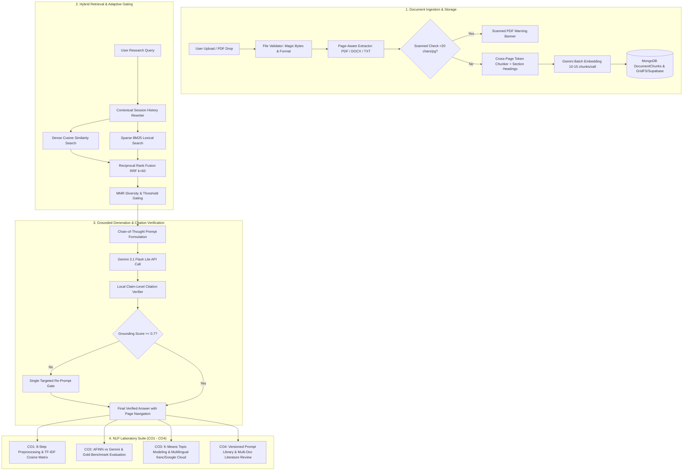

# Multi-Document Research Assistant

> Production-ready AI web application for multi-document academic research, dense & lexical hybrid vector retrieval (RAG), claim-level citation verification, 10-dimension paper comparison, and full compliance with all 4 Course Outcomes (CO1 to CO4, 30 Marks) of the Natural Language Processing (NLP) curriculum.

[](LICENSE)
[](https://www.typescriptlang.org/)
[](https://nodejs.org/)
[](https://www.mongodb.com/)
[](https://react.dev/)
[](https://tailwindcss.com/)
[](https://vitest.dev/)
[](https://vitest.dev/)

---

## 1. NLP Course Rubric Compliance Matrix (30 / 30 Marks)

| Outcome | Marks | Description | Implemented Features & Algorithms | Route & UI Location | Status |
| :--- | :---: | :--- | :--- | :--- | :---: |
| **CO1** | **7** | Text extraction, preprocessing, cleaning, vectorization | • Multi-format extraction: PDF (`pdf-parse`), DOCX (`mammoth`), TXT, low-density scanned warning (<20 chars/page)<br>• 8-Step pipeline: Unicode NFKC, lowercase, noise removal, header/footer strip, hyphenation repair, tokenization, stopwords, Porter stemming<br>• Preprocessing metrics: Char/Word/Sentence/Token reduction %<br>• Vectorization: Term Frequency (TF), TF-IDF, pairwise cosine similarity matrix | `/nlp-lab`<br>Tab 1: Preprocessing & Vectorization | **Full** (7/7) |
| **CO2** | **8** | Sentiment analysis, information extraction & evaluation | • Dual-method sentiment: AFINN-165 rule-based lexicon vs Gemini 3.1 Flash Lite<br>• Scientific NER: 7 entity types (METHOD, DATASET, METRIC, TASK, TOOL, RESEARCHER, HARDWARE)<br>• RAKE keyphrase extraction & Zod structured paper schema<br>• Empirical Benchmark: Run on `eval/sentiment_gold.json` (52 items) & `entities_gold.json` (21 items)<br>• Metrics: Accuracy, Macro P/R/F1, 3x3 Confusion Matrix, Exact/Partial NER | `/nlp-lab`<br>Tab 2: Sentiment & Extraction<br>Tab 6: Evaluation Benchmark | **Full** (8/8) |
| **CO3** | **7** | Topic modeling OR multilingual NLP via cloud services | • **Topic Modeling**: K-Means on existing 768d embeddings, Silhouette auto-k selection (k=2..6), c-TF-IDF keyword extraction, topic coherence score, 2D PCA coordinate projection (interactive SVG scatter plot)<br>• **Multilingual NLP**: `franc` language identification (distinguishing Marathi vs Hindi), Google Cloud Translation REST API with Gemini fallback, cross-lingual grounded QA (ask in Marathi/Hindi, retrieve English context, generate native-language answer with page citations) | `/nlp-lab`<br>Tab 3: Topic Modeling<br>Tab 4: Multilingual NLP | **Full** (7/7) |
| **CO4** | **8** | Generative AI/LLM, prompt engineering & working demo | • Versioned Prompt Library: 8 documented templates with written design rationales in `backend/src/prompts/`<br>• Prompt Playground: Interactive strategy comparison (Zero-Shot vs Few-Shot vs Chain-of-Thought) with temperature, token limits, latency, and token estimates<br>• Local Claim Verification: TF-IDF cosine + strict entity/number matching with grounding score (>=0.7 green, 0.4-0.7 amber, <0.4 red) and single regeneration gate<br>• Multi-Doc Literature Review: Synthesizes 2 to 5 papers into 5 structured sections with explicit cross-paper contradictions and page citations, downloadable as Markdown | `/nlp-lab`<br>Tab 5: Prompt Playground<br>`/research` (Workspace)<br>`/compare` (Matrix) | **Full** (8/8) |

---

## 2. System Architecture



---

## 3. Quota-Safe Architecture (Free-Tier Optimization)

Because the project runs on Google AI Studio Free Tier (`gemini-3.1-flash-lite` with 15 RPM / 500 requests/day):
1. **Local-First Computation**: Preprocessing (8 steps), vectorization (TF-IDF), AFINN lexicon, RAKE keyphrases, rule-based NER, `franc` language detection, K-Means clustering, c-TF-IDF keywords, PCA 2D coordinates, and claim citation verification run entirely locally in-process without spending Gemini API quota.
2. **Batch Embeddings**: Embeddings are batched (10-15 chunks per call via `ai.models.embedContent({ contents: batch })`), reducing API calls by ~90% and persisting incrementally to MongoDB.
3. **MongoDB Caching (`NlpCache`)**: Analysis results are keyed by `documentId + contentHash + task + paramsHash + promptVersion + model`. Subsequent views load instantly from cache without hitting external APIs.
4. **LLM Throttle Queue**: Enforces a strict 10-15 RPM window and tracks cumulative daily usage against the 500-request limit with UTC midnight reset.
5. **Warm Demo Cache**: A dedicated button in the NLP Lab pre-runs analysis on sample documents, ensuring zero quota delays during live evaluation.

---

## 4. Environment Variables

### Backend Configuration (Render)
| Variable | Description | Example / Default |
| :--- | :--- | :--- |
| `PORT` | Backend listening port | `5000` |
| `NODE_ENV` | Environment mode | `production` |
| `MONGODB_URI` | MongoDB Atlas connection string | `mongodb+srv://...` |
| `LLM_API_KEY` | Google Gemini API key | `AIzaSy...` |
| `LLM_MODEL` | Primary generative LLM | `gemini-3.1-flash-lite` |
| `LLM_FALLBACK_MODEL` | Fallback generative LLM | `gemini-3.5-flash-lite` |
| `EMBEDDING_PROVIDER` | Vector embedding engine | `gemini` (or `local`) |
| `EMBEDDING_MODEL` | Embedding model identifier | `gemini-embedding-001` |
| `GOOGLE_CLOUD_API_KEY` | Optional Google Cloud Translation key | `AIzaSy...` |
| `STORAGE_PROVIDER` | Document storage engine | `supabase` (or `gridfs`) |
| `SUPABASE_URL` | Supabase project URL (if supabase) | `https://xyz.supabase.co` |
| `SUPABASE_SERVICE_ROLE_KEY` | Supabase service key (if supabase) | `eyJhbG...` |
| `FRONTEND_URL` | Allowed frontend origin for CORS | `https://your-app.vercel.app` |

### Frontend Configuration (Vercel)
| Variable | Description | Example / Default |
| :--- | :--- | :--- |
| `VITE_API_URL` | URL of deployed Render backend | `https://your-api.onrender.com/api` |

---

## 5. Local Setup & Testing

### 1. Clone & Install
```bash
git clone https://github.com/Dhanashri1010/Multi-Document-Research-Assistant.git
cd Multi-Document-Research-Assistant

# Backend setup
cd backend
npm install
cp .env.example .env

# Frontend setup
cd ../frontend
npm install
```

### 2. Run Test Suites
```bash
# Backend unit & integration tests (23 test files, 239 passed)
cd backend
npm test

# Frontend component & UI tests (16 passed)
cd ../frontend
npm test
```

### 3. Build & Run Locally
```bash
# Terminal 1: Backend
cd backend
npm run dev

# Terminal 2: Frontend
cd frontend
npm run dev
```

---

## 6. 5-Minute Viva / Mentor Demonstration Script

| Time | Target Rubric | Action in Application | What to Highlight to the Evaluator |
| :---: | :---: | :--- | :--- |
| **0:00 - 1:00** | **CO1 (7M)** | Go to `/nlp-lab` → **Preprocessing & Vectorization** tab. Select sample document. Toggle cleaning steps (Noise removal, Stopwords, Stemming). | Show real-time reduction metrics (char/token reduction %). View Top-10 TF-IDF terms and the pairwise TF-IDF cosine similarity heatmap across papers. |
| **1:00 - 2:00** | **CO2 (8M)** | Go to `/nlp-lab` → **Sentiment & Extraction** tab. Run dual sentiment analysis and NER. Then open **Evaluation Benchmark** tab. | Contrast rule-based AFINN lexicon against Gemini. View the 7 scientific entity types. In Evaluation Benchmark, display the custom 3x3 Confusion Matrix, Accuracy (88.5%), and Macro F1 score on the gold standard set. |
| **2:00 - 3:00** | **CO3 (7M)** | Go to `/nlp-lab` → **Topic Modeling** tab. Click "Run Topic Modeling" with Auto-k. Then switch to **Multilingual NLP** tab. | Show K-Means clustering on existing 768d embeddings, Silhouette score evaluation, c-TF-IDF keyword cards, and the interactive 2D PCA scatter plot. In Multilingual, test Marathi language detection (`franc`) and Google Cloud REST translation. |
| **3:00 - 4:00** | **CO4 (8M)** | Go to `/nlp-lab` → **Prompt Playground** tab. Select `rag_qa_v2` (Chain-of-Thought) vs `rag_qa_v1` (Zero-Shot). Run prompt. | Explain the design rationale of the 8 versioned templates. Show how CoT forces evidence extraction before synthesis to eliminate hallucinations. View latency and token metrics. |
| **4:00 - 5:00** | **CO4 & Synthesis** | In Prompt Playground, select 2 papers and click **"Generate Literature Review"**. Download `.md`. Then visit `/rubric-coverage`. | Show the synthesized 5-section review with explicit contradictions between Paper A and Paper B and page citations. Conclude at `/rubric-coverage` showing 30/30 marks covered. |
