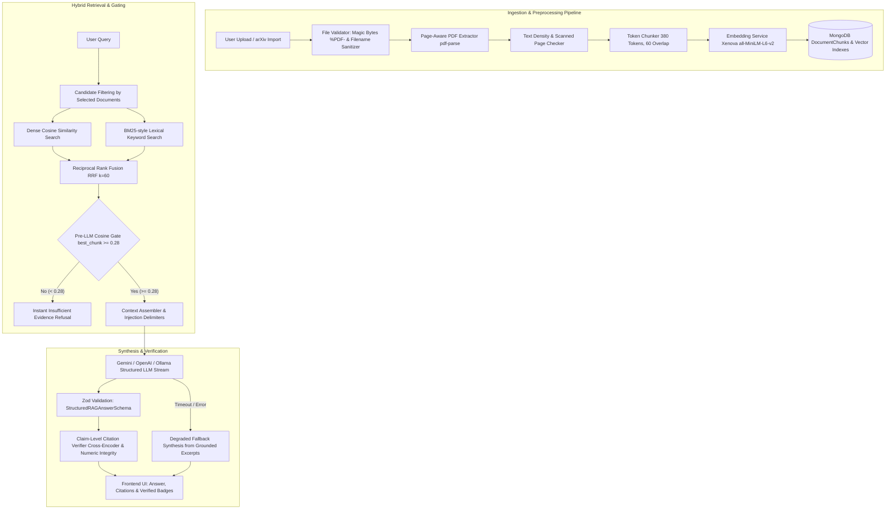

# Multi-Document Research Assistant

> Production-grade NLP web application for academic literature cross-analysis, dense semantic vector retrieval, Retrieval-Augmented Generation (RAG), and evidence-grounded comparative synthesis.

[](LICENSE)
[](https://www.typescriptlang.org/)
[](https://nodejs.org/)
[](https://www.mongodb.com/)
[](https://react.dev/)
[](https://tailwindcss.com/)

---

## 1. System Architecture

The Multi-Document Research Assistant extracts, parses, embeds, and indexes multi-page academic papers (PDF/TXT) with strict page-level attribution. Queries undergo dense vector retrieval, Reciprocal Rank Fusion (RRF), a pre-LLM cosine similarity gate, and Zod-enforced structured generation with claim-level citation verification.



---

## 2. Key Features

### In-App PDF Viewer with Page Jumping
- When citations appear under research answers or comparisons, users can click **"Open in PDF Viewer at Page X"**.
- A modal opens embedding the original PDF with `#page=${pageNumber}`, jumping straight to the cited evidence without leaving the workspace.
- Supports external tab view and raw PDF download.

### Full-Fidelity Markdown Export
- **Research Answers**: Export answers with date, question, degraded notices, and complete numbered citations directly to `.md`.
- **Comparative Analysis**: Export structured Markdown tables of the 8 academic evaluation dimensions, key findings, similarities, differences, limitations, and citations.

### Real-Time Reliability & Safety Notices
- **Degraded Synthesis Mode**: Explicit banner shown across both Q&A and Compare when the LLM service times out or falls back to extracted passage excerpts.
- **Unverified Citation Warning**: Citations with semantic conflict or mismatched numerical claims are flagged with an amber warning badge.
- **Low Text Density / Scanned PDF Warning**: Flagged automatically during ingestion when pages contain minimal text, advising OCR usage.

### Collections & Projects
- Group uploaded papers into research collections (e.g. `Transformers`, `Efficiency`, `Computer Vision`).
- Filter documents in the repository and multi-document selector by collection.

### Direct arXiv Import
- Paste any arXiv abstract or PDF URL (e.g., `https://arxiv.org/abs/2106.09685` or `2106.09685`).
- The backend downloads the PDF, validates `%PDF-` magic bytes, extracts metadata, indexes passages into MongoDB, and optionally assigns it to a collection.

---

## 3. Empirical Benchmark & Evaluation

All retrieval metrics and generative answer rates are benchmarked against 75 evaluation queries across 6 real academic papers (`Attention Is All You Need`, `LoRA`, `BERT`, `ResNet`, `GPT-3`, `Adam`, and `Unmasking AI-Generated Texts`).

The dataset is partitioned into **Tuning** ($n=29$), **Seen Held-Out** ($n=16$), and a **Mostly Blind Set** ($n=15$, queries `q61`–`q75`):

| Evaluation Split | Metric / Matching Type | Hit@1 | Hit@3 | Hit@5 | MRR |
| :--- | :--- | :---: | :---: | :---: | :---: |
| **Tuning Set** ($n=29$) | **Strict Exact Match** | 44.8% | 69.0% | 75.9% | 0.564 |
| | **Span-Only Match** | 55.2% | 79.3% | 86.2% | 0.676 |
| | **Normalized Match** | **75.9%** | **89.7%** | **93.1%** | **0.829** |
| **Seen Held-Out** ($n=16$) | **Strict Exact Match** | 43.8% | 62.5% | 68.8% | 0.563 |
| | **Span-Only Match** | 62.5% | 81.3% | 87.5% | 0.750 |
| | **Normalized Match** | **81.3%** | **93.8%** | **100.0%** | **0.906** |
| **Mostly Blind** ($n=15$, `q61`–`q75`) | **Strict Exact Match** | 20.0% | 40.0% | 40.0% | 0.261 |
| | **Span-Only Match** | 20.0% | 46.7% | 46.7% | 0.283 |
| | **Normalized Match** | **86.7%** | **93.3%** | **93.3%** | **0.880** |
| **Overall Grounded** ($n=60$) | **Strict Exact Match** | 38.3% | 60.0% | 65.0% | 0.488 |
| | **Span-Only Match** | 48.3% | 71.7% | 76.7% | 0.598 |
| | **Normalized Match** | **80.0%** | **91.7%** | **95.0%** | **0.862** |

### Answer Rate & Refusal Performance (Full Pipeline)
- **Grounded Answer Rate** (3-Run Mean @ Temperature 0.0): **90.6% ± 1.7%** (Target: $\ge 88\%$)
- **Grounded Answer Correctness**: **98.2%**
- **Out-of-Domain Refusal Accuracy** ($n=6$): **100.0%**
- **In-Domain Deceptive Trap Refusal Accuracy** ($n=9$): **88.9%**
- **Overall Off-Topic Refusal Accuracy** ($n=15$): **93.3%**

---

## 4. Quick Start & Setup

### Prerequisites
- Node.js $\ge 20.0$
- MongoDB $\ge 6.0$ (running locally at `mongodb://127.0.0.1:27017` or MongoDB Atlas URI)

### Installation
Clone the repository and install all workspace dependencies:
```bash
git clone https://github.com/Dhanashri1010/Multi-Document-Research-Assistant.git
cd Multi-Document-Research-Assistant

# Install backend and frontend dependencies
npm --prefix backend install
npm --prefix frontend install
```

### Environment Configuration
Copy `.env.example` to `backend/.env`:
```bash
cp .env.example backend/.env
```

| Environment Variable | Default | Purpose |
| :--- | :--- | :--- |
| `PORT` | `5000` | Backend API server port |
| `FRONTEND_URL` | `http://localhost:5173` | Allowed CORS origin |
| `MONGODB_URI` | `mongodb://127.0.0.1:27017/multi_doc_research` | MongoDB connection URI |
| `UPLOAD_DIR` | `./uploads` | Storage directory for uploaded PDF files |
| `MAX_FILE_SIZE_MB` | `25` | Maximum upload file size limit |
| `VECTOR_SEARCH_PROVIDER` | `local` | `local` (in-memory cosine) or `atlas` ($vectorSearch) |
| `EMBEDDING_PROVIDER` | `local` | `local` (`all-MiniLM-L6-v2`), `gemini`, or `openai` |
| `CHUNK_TARGET_TOKENS` | `380` | Target token length for passages |
| `CHUNK_OVERLAP_TOKENS` | `60` | Overlap between adjacent chunks |
| `LLM_PROVIDER` | `gemini` | `gemini`, `openai`, `ollama`, or `mock` |
| `LLM_MODEL` | `gemini-3.5-flash-lite`| Configured generative LLM model |
| `LLM_API_KEY` | *(empty)* | API key for Gemini or OpenAI |
| `PRE_LLM_COSINE_THRESHOLD` | `0.28` | Pre-LLM refusal gate similarity threshold |
| `COMPARE_TIMEOUT_MS` | `30000` | Timeout budget for cross-paper comparative analysis |
| `RERANKER` | `off` | `off` or `on` (cross-encoder reranking) |

### Ingestion & Seeding
To index the benchmark research papers into your local MongoDB:
```bash
npm run reingest
```

### Running the Application
```bash
# Terminal 1: Start Backend API
npm run dev:backend

# Terminal 2: Start Frontend UI
npm run dev:frontend
```
Open [http://localhost:5173](http://localhost:5173) in your browser.

---

## 5. Testing & Evaluation

### Run All Unit and Component Tests
```bash
# Runs 62 backend tests + 7 frontend component tests
npm test
```

### Run Evaluation Suites
```bash
# Full retrieval benchmark over all 75 queries
npm run eval:retrieval --prefix backend

# Citation verifier precision/recall test on labeled pairs
npm run eval:citations --prefix backend

# Full-pipeline answer rate and trap refusal evaluation
npm run eval:pipeline --prefix backend
```

### Code Quality & Linting
```bash
# Backend ESLint (ESLint 10 Flat Config)
npm run lint --prefix backend

# Frontend Oxlint
npm run lint --prefix frontend

# Typecheck and production build
npm run build
```

---

## 6. Known Limitations & Scope Boundaries

1. **Table Column Ordering**: PDF text extraction flattens complex multi-column grid tables into sequential text streams. Strict string matching on multi-cell tables is sensitive to column interleaving.
2. **Scanned & Image-Only PDFs**: Text extraction relies on raw text streams. For scanned or rasterized PDFs, a "Low text density · OCR recommended" banner is flagged. Native OCR engine integration is not bundled in the local sandbox.
3. **Multi-Document Dispersed Evidence**: For broad queries requiring joint synthesis across 5+ documents, retrieval top-k per document must be balanced to fit context windows.
4. **Local Hardware Constraints**: Running local embeddings (`all-MiniLM-L6-v2`) in Node.js CPU processes takes approximately 80–120ms per query.

---

## 7. License

This project is licensed under the MIT License — see the [LICENSE](LICENSE) file for details.
