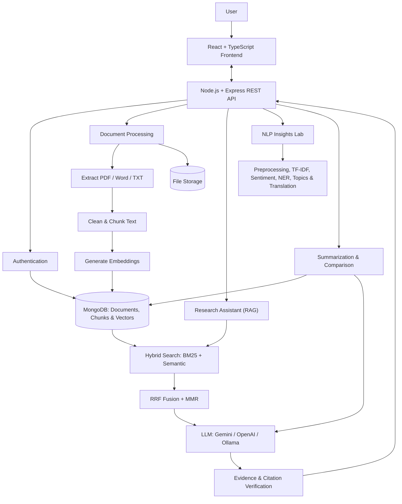

# Multi-Document Research Assistant

A web application that helps students and researchers work with multiple documents in one place. Instead of reading every page to find a particular detail, users can upload their documents, ask questions, generate summaries, and compare information across different sources.

We built this project as part of our **Natural Language Processing (NLP)** coursework to explore how traditional text-processing techniques and modern AI models can work together in a useful research tool.

## What the project does

- **Upload documents:** Work with PDF, Word (`.doc`, `.docx`), and text (`.txt`) files.
- **Ask questions:** Search across selected documents and receive answers based on relevant passages, with references to the source material.
- **Summarize and compare:** Get an overview of a document or compare key points across multiple research papers.
- **Explore NLP techniques:** Try text preprocessing, TF-IDF, sentiment analysis, named entity recognition, topic modeling, and multilingual tools through the NLP Insights section.
- **Review supporting evidence:** Check the passages used to produce an answer instead of relying on a response without context.

## How it works

When a document is uploaded, the application extracts its text, cleans it, and divides it into smaller sections. These sections are stored with information about where they came from.

When a user asks a question, the system looks for relevant sections using a combination of semantic search and keyword-based search. It then uses the retrieved text to generate a response and provide source references. This approach is called **Retrieval-Augmented Generation (RAG)**.

The application also includes an **NLP Insights** section where users can explore individual NLP concepts and see how different techniques process and analyze text.

## Technologies used

| Area | Technologies |
| --- | --- |
| Frontend | React, TypeScript, Vite, Tailwind CSS |
| Backend | Node.js, Express, TypeScript |
| Database | MongoDB, Mongoose |
| NLP and retrieval | Sentence Transformers, BM25, semantic search, RAG |
| AI integration | Configurable language-model providers, including Gemini, OpenAI, and Ollama |
| Testing | Vitest |


## System Architecture

The Multi-Document Research Assistant is built using a full-stack architecture that connects a React frontend with a Node.js backend, a MongoDB database, and NLP-based processing services.

The application has three main functions: processing uploaded documents, answering research questions, and providing an interactive NLP laboratory.



### How the System Works

**1. Frontend**

The user interacts with a web application developed using React and TypeScript. It provides pages for uploading documents, asking questions, comparing research papers, and exploring NLP tools.

**2. Backend**

The Node.js and Express backend handles API requests, user authentication, document processing, database operations, and communication with NLP services.

**3. Document Processing**

Uploaded PDF, Word, and text documents are processed to extract their content. The extracted text is cleaned and divided into smaller overlapping chunks. Each chunk is converted into a numerical embedding and stored with its document information.

**4. Hybrid Search and RAG**

When a user asks a question, the system searches relevant document chunks using both semantic similarity and BM25 keyword matching. The results are combined using Reciprocal Rank Fusion (RRF), while Maximal Marginal Relevance (MMR) helps reduce duplicate information.

The selected passages are passed to a language model to generate an answer based on the available evidence.

**5. Citation Verification**

The system checks how well generated claims are supported by retrieved passages and provides references to the source documents.

**6. NLP Insights Lab**

Alongside the research assistant, the project includes an NLP laboratory for exploring text preprocessing, TF-IDF, sentiment analysis, named entity recognition, topic modeling, and multilingual processing.

**7. Database and Storage**

MongoDB stores user accounts, document information, text chunks, embeddings, and research sessions. Uploaded files are handled through configurable storage options, including MongoDB GridFS, Supabase, or local storage.

Together, these components allow users to manage multiple documents, retrieve relevant information, and perform NLP-based research analysis through a single interface.

## Getting started

### Requirements

- Node.js and npm
- A running MongoDB instance (local or cloud-hosted)
- API credentials if using a hosted language-model provider

### 1. Install dependencies

From the project folder, run:

```bash
npm install --prefix backend
npm install --prefix frontend
```

### 2. Set up environment variables

Create a `backend/.env` file using `backend/.env.example` as a reference. Add your database connection and the settings for the AI provider you want to use.

**Do not upload your `.env` file or API keys to GitHub.**

### 3. Start the application

Run the backend:

```bash
npm run dev:backend
```

In a second terminal, run the frontend:

```bash
npm run dev:frontend
```

Open the local URL shown in your frontend terminal (usually `http://localhost:5173`).

## Project structure

- `frontend/` — user interface and application pages
- `backend/` — API routes, document processing, NLP services, and database models
- `samples/` — sample documents for exploring the application
- `docs/` — additional documentation and evaluation notes

## Testing and evaluation

The repository includes tests and evaluation material for document retrieval and other NLP features. To run the available backend tests:

```bash
npm run test:backend
```

For the documented evaluation setup and results, see [`docs/EVAL_RESULTS.md`](docs/EVAL_RESULTS.md). These results describe specific test datasets and should not be interpreted as the accuracy of every feature or answer.

## Limitations and future improvements

The application is an academic project and still has room to improve. In particular, scanned PDFs may need OCR before they can be analyzed properly, and AI-generated answers should be checked against their cited passages.

Future work could include OCR support, testing on larger collections of research papers, and improving answer and citation reliability.

## Project team

**Dhanashri Khatavkar** — PRN: 202502110005  
**Atulya Mishra** — PRN: 202401110051

**Course:** Natural Language Processing (NLP)  
**Department:** Computer Science / AI & ML
