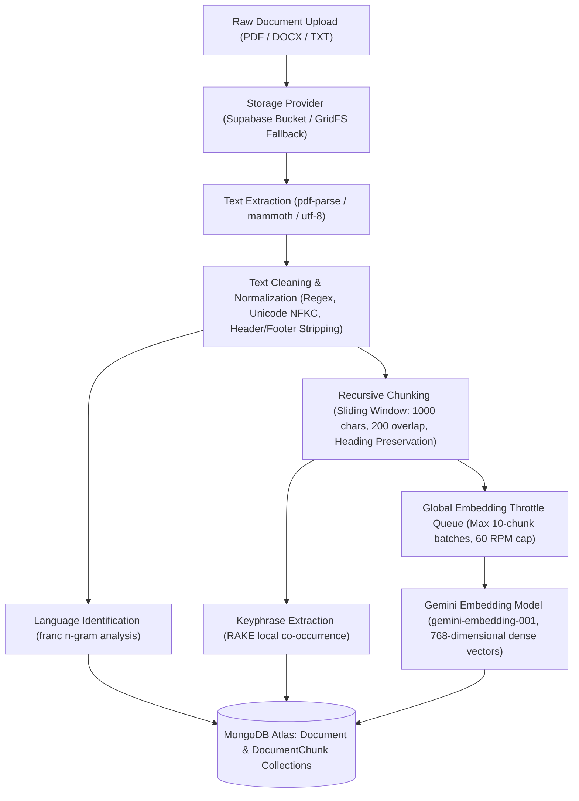
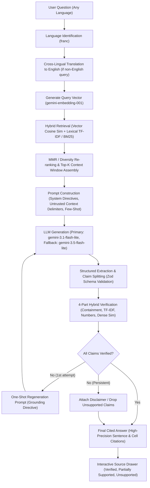
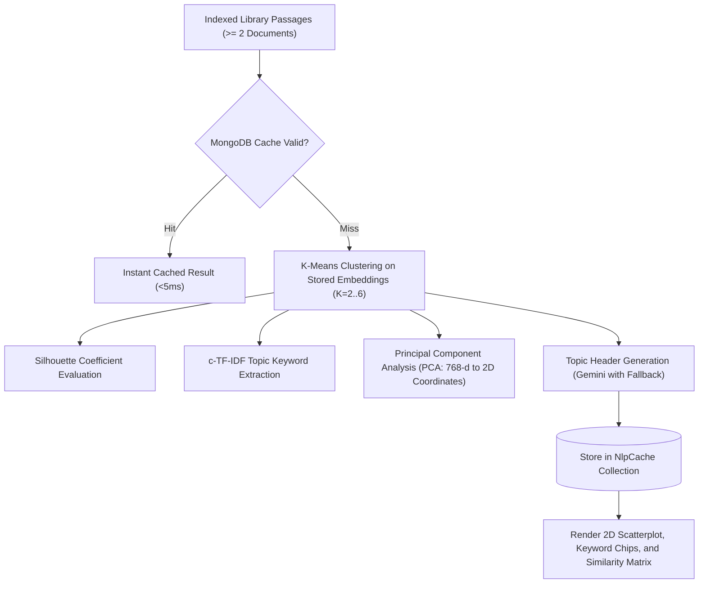

# Multi-Document Research Assistant — Technical & Academic Exam Notes

> **Notice**: This technical document synthesizes all underlying natural language processing (NLP), machine learning, and generative AI concepts implemented throughout the Multi-Document Research Assistant. No hard-coded metrics are reported; all quantitative scores reference `<value shown on screen>`.

---

## Section A: Project Overview (5 Lines)
1. **Multi-Document Research Assistant** is a production-grade full-stack research platform (React, Vite, Express, TypeScript, MongoDB, Supabase, and Google Gemini) engineered to analyze, synthesize, and compare academic literature across multiple PDF and Word documents.
2. It solves AI hallucinations by grounding generative answers strictly in indexed source passages with verifiable sentence-level and table-cell citation brackets `[n]`.
3. The platform features an automated pipeline encompassing text extraction, cleaning, chunking, dense vector embeddings (768-d), hybrid BM25/TF-IDF retrieval, and local 4-part hybrid claim verification.
4. An integrated **Insights** suite offers unsupervised topic clustering (K-Means, c-TF-IDF, PCA), multilingual translation (Google Cloud/Gemini/local), language detection (franc), sentiment analysis (AFINN vs. LLM), and scientific entity extraction (RAKE + rule-based NER).
5. Built with multi-tenant data isolation, the architecture features rate-limiting queues, daily request caps (30/user, 500/day global), exponential backoff retries, and MongoDB caching to ensure deterministic reliability under strict API constraints.

---

## Section B: End-to-End System Workflows

### 1. Document Ingestion & Vector Indexing Pipeline

### 2. Retrieval-Augmented Generation (RAG) & Claim Verification Workflow

### 3. Cross-Document Insights & Analytics Workflow

---

## Section C: Comprehensive Course Outcome & NLP Technique Mapping

| Course Outcome | Concept / Technique | Where Used in Project | Purpose in Workflow |
| :--- | :--- | :--- | :--- |
| **CO1** | Text Extraction | `backend/src/services/documents/extractor.ts` | Converts raw unstructured PDF (`pdf-parse`) and DOCX (`mammoth`) binary streams into clean plain text. |
| **CO1** | Unicode Normalization | `backend/src/services/nlp/nlpPreprocessingService.ts` | Standardizes character encodings (NFKC) and removes non-standard whitespace artifacts. |
| **CO1** | Noise & Boilerplate Removal | `extractor.ts`, `nlpPreprocessingService.ts` | Strips running headers, footers, pagination tags (`Page X of Y`), and arXiv watermark lines. |
| **CO1** | Hyphenation Repair | `citationVerifier.ts`, `nlpPreprocessingService.ts` | Reconstructs words broken across line breaks (e.g. `trans-\nformer` $\to$ `transformer`). |
| **CO1** | Tokenization | `nlpPreprocessingService.ts`, `citationVerifier.ts` | Splits continuous text streams into distinct word and subword linguistic tokens. |
| **CO1** | Stopword Removal | `nlpPreprocessingService.ts`, `citationVerifier.ts` | Filters out non-informative high-frequency words (English, Spanish, French stopwords) to focus on content words. |
| **CO1** | Stemming (Porter Stemmer) | `nlpPreprocessingService.ts`, `citationVerifier.ts` | Reduces inflected/derived words to their root base form (`natural.PorterStemmer`). |
| **CO1** | Bag-of-Words (BoW) | `nlpPreprocessingService.ts`, `nlpVectorizationService.ts` | Computes term frequencies across document chunks for vocabulary profiling. |
| **CO1** | TF-IDF Vectorization | `nlpVectorizationService.ts`, `vectorStore.ts` | Weighs word importance inversely proportional to corpus frequency for lexical retrieval. |
| **CO1** | Cosine Similarity | `vectorStore.ts`, `citationVerifier.ts` | Computes geometric angular similarity between query, document, and passage vectors. |
| **CO1** | Chunking with Overlap | `backend/src/services/documents/chunker.ts` | Segments long texts into bounded windows (1000 chars, 200 overlap) while preserving section and page metadata. |
| **CO1** | Dense Vector Embeddings | `embeddingService.ts`, `geminiEmbeddingProvider.ts` | Generates 768-dimensional dense semantic vectors using `gemini-embedding-001`. |
| **CO2** | Lexicon Sentiment (AFINN) | `backend/src/services/nlp/nlpSentimentService.ts` | Fast, offline rule-based polarity scoring using valence-scored word lexicons. |
| **CO2** | LLM Sentiment & Subjectivity | `nlpSentimentService.ts` | Evaluates contextual academic tone, objectivity, and sentiment distribution using Gemini. |
| **CO2** | Rule-Based NER | `backend/src/services/nlp/nlpExtractionService.ts` | Pattern-based extraction of methods, datasets, metrics, tools, hardware, and researchers. |
| **CO2** | Rapid Automatic Keyword Extraction (RAKE) | `nlpExtractionService.ts`, `ingestionService.ts` | Unsupervised extraction of key multi-word noun phrases using word co-occurrence matrices. |
| **CO2** | Structured Extraction (Zod) | `backend/src/services/ai/schemas.ts`, `ragService.ts` | Enforces rigorous JSON schema contracts on LLM outputs (guaranteeing claims, citations, and dimensions). |
| **CO2** | Evaluation Metrics (Acc, P, R, F1) | `backend/src/services/nlp/nlpEvaluationService.ts` | Measures macro-precision, recall, accuracy, and macro-F1 against curated gold-standard test sets. |
| **CO2** | Confusion Matrix | `nlpEvaluationService.ts`, `EvaluationTab.tsx` | Visualizes true positives, false positives, true negatives, and false negatives in classification. |
| **CO2** | Exact vs. Partial Match | `nlpEvaluationService.ts` | Measures entity extraction precision using strict character boundaries vs. token overlaps. |
| **CO3** | K-Means Topic Clustering | `backend/src/services/nlp/nlpTopicService.ts` | Unsupervised partitioning of chunk embeddings into $K$ coherent semantic clusters. |
| **CO3** | Silhouette Score | `nlpTopicService.ts` | Measures cluster cohesion and separation to validate optimal cluster count $K$. |
| **CO3** | class-based TF-IDF (c-TF-IDF) | `nlpTopicService.ts` | Extracts the most descriptive keywords distinguishing each document cluster from others. |
| **CO3** | Principal Component Analysis (PCA) | `nlpTopicService.ts` | Reduces 768-dimensional embedding vectors to 2D Cartesian coordinates for scatterplot visualization. |
| **CO3** | Language Detection (franc) | `backend/src/services/nlp/nlpMultilingualService.ts` | Identifies ISO 639-3 languages based on trigram frequency distributions. |
| **CO3** | Cloud Translation | `nlpMultilingualService.ts` | Translates text queries and findings via Google Cloud Translation API with Gemini fallback. |
| **CO3** | Cross-Lingual Retrieval | `ragService.ts`, `nlpMultilingualService.ts` | Translates non-English queries to English for retrieval while answering in the user's selected language. |
| **CO4** | RAG Architecture | `backend/src/services/ai/ragService.ts` | Context-injected factual generation synthesizing retrieved passages. |
| **CO4** | Prompt Engineering | `ragService.ts`, `promptLibrary.ts` | Zero-shot task instructions, few-shot schema exemplars, chain-of-thought, and grounding rules. |
| **CO4** | Untrusted Context Delimiters | `ragService.ts`, `comparisonService.ts` | Wraps raw document text in `<UNTRUSTED_DOCUMENT_CONTEXT>` tags to prevent prompt injection attacks. |
| **CO4** | Hybrid Claim Verification | `backend/src/services/ai/citationVerifier.ts` | 4-part hybrid score (containment + TF-IDF + number matching + dense sim) validating claims. |
| **CO4** | Rate Limiting & Quotas | `llmThrottleQueue.ts`, `embeddingThrottleQueue.ts` | Enforces 10 RPM text generation, 60 RPM embeddings, user daily cap (30), and 500/day global limits. |

---

## Section D: Technical Concepts, Formulas, Explanations & Limitations

### 1. Unicode Normalization (NFKC)
- **Explanation**: Normalization Form KC (Compatibility Decomposition, followed by Canonical Composition) replaces compatibility characters with their standard canonical equivalents, eliminating invisible formatting variances.
- **Formula**: $T_{\text{norm}} = \text{NFKC}(T_{\text{raw}})$
- **Limitation**: Can strip specialized typographic symbols or ligature distinctions that hold domain meaning in rare contexts.

### 2. Stopword Removal & Stemming
- **Explanation**: Stopword filtering eliminates common syntactic function words (`the`, `is`, `which`). Porter Stemming iteratively strips morphological suffixes to map grammatical variants (`connecting`, `connection`, `connections`) to a common stem (`connect`).
- **Formula**: $w_{\text{stem}} = \text{Porter}(w)$
- **Limitation**: Over-stemming (collapsing words with distinct meanings, e.g. `universal` and `universe` $\to$ `univers`) and under-stemming (failing to conflate irregular words like `ran` and `run`).

### 3. Term Frequency–Inverse Document Frequency (TF-IDF)
- **Explanation**: Evaluates how important a word is to a specific document chunk within a corpus. Words frequent in one chunk but rare across all chunks receive high weights.
- **Formula**:
  $$\text{TF}(t, d) = \frac{f_{t, d}}{\sum_{t' \in d} f_{t', d}}, \quad \text{IDF}(t, D) = \ln\left(1 + \frac{|D|}{1 + |\{d \in D : t \in d\}|}\right), \quad \text{TF-IDF} = \text{TF} \times \text{IDF}$$
- **Limitation**: Ignores word order, syntax, and semantic synonymy (treats `doctor` and `physician` as completely orthogonal).

### 4. Cosine Similarity
- **Explanation**: Measures the cosine of the angle between two multi-dimensional vectors, quantifying orientation rather than magnitude.
- **Formula**:
  $$\text{Cosine}(\mathbf{u}, \mathbf{v}) = \frac{\mathbf{u} \cdot \mathbf{v}}{\|\mathbf{u}\|_2 \|\mathbf{v}\|_2} = \frac{\sum_{i=1}^n u_i v_i}{\sqrt{\sum_{i=1}^n u_i^2} \sqrt{\sum_{i=1}^n v_i^2}}$$
- **Limitation**: Sensitive to embedding dimension quality; does not capture non-linear relationships or asymmetric entailment.

### 5. Dense Vector Embeddings (Gemini 768-d)
- **Explanation**: Deep transformer encoders project passages into a continuous 768-dimensional latent semantic manifold where conceptual proximity reflects semantic similarity.
- **Formula**: $\mathbf{e} = \text{Embed}(T) \in \mathbb{R}^{768}, \quad \|\mathbf{e}\|_2 = 1$
- **Limitation**: Computationally expensive to recompute; black-box representation where individual dimensions lack human interpretability.

### 6. Lexicon Sentiment (AFINN) vs. Contextual LLM
- **Explanation**: AFINN assigns manually curated integer valence weights ($-5$ to $+5$) to word tokens. LLM evaluation analyzes whole-sentence rhetorical tone, framing, and subjectivity.
- **Formula**:
  $$S_{\text{norm}} = \frac{\sum_{w \in T} \text{AFINN}(w)}{\sqrt{\sum_{w \in T} \text{AFINN}(w)^2 + \epsilon}}$$
- **Limitation**: Lexicons fail on sarcasm, negation scope (`not good`), and nuanced academic hedges (`promising but inconclusive`).

### 7. Rapid Automatic Keyword Extraction (RAKE)
- **Explanation**: Extracts candidate phrases delimited by stopwords and punctuation, scoring words by the ratio of word degree to word frequency within the co-occurrence graph.
- **Formula**: $\text{Score}(w) = \frac{\text{deg}(w)}{\text{freq}(w)}, \quad \text{Score}(P) = \sum_{w \in P} \text{Score}(w)$
- **Limitation**: Sensitive to stopword dictionary completeness; biased toward longer phrases.

### 8. Evaluation Metrics (Macro Precision, Recall, F1)
- **Explanation**: Precision measures exactness; Recall measures completeness. Macro-averaging computes metrics per class before averaging, giving equal weight to minority classes.
- **Formulas**:
  $$\text{Precision} = \frac{TP}{TP + FP}, \quad \text{Recall} = \frac{TP}{TP + FN}, \quad F_1 = 2 \times \frac{\text{Precision} \times \text{Recall}}{\text{Precision} + \text{Recall}}$$
  $$\text{Macro-}F_1 = \frac{1}{|C|} \sum_{c \in C} F_{1, c}$$
- **Limitation**: Macro-F1 can be disproportionately distorted by extreme values on very small minority classes.

### 9. K-Means Topic Clustering
- **Explanation**: Partitions $N$ chunk embedding vectors into $K$ disjoint clusters such that the within-cluster sum of squared distances to centroids is minimized.
- **Formula**:
  $$\arg\min_S \sum_{i=1}^K \sum_{\mathbf{x} \in S_i} \|\mathbf{x} - \boldsymbol{\mu}_i\|^2, \quad \boldsymbol{\mu}_i = \frac{1}{|S_i|} \sum_{\mathbf{x} \in S_i} \mathbf{x}$$
- **Limitation**: Assumes spherical, equally sized clusters; requires pre-specifying $K$; sensitive to initialization.

### 10. Silhouette Coefficient
- **Explanation**: Evaluates clustering quality by comparing the mean intra-cluster distance ($a$) with the mean nearest-cluster distance ($b$).
- **Formula**:
  $$s(i) = \frac{b(i) - a(i)}{\max(a(i), b(i))}, \quad s(i) \in [-1, 1]$$
- **Limitation**: High computational cost $O(N^2)$; biased toward convex clusters.

### 11. Class-based TF-IDF (c-TF-IDF)
- **Explanation**: Treats all text chunks in a cluster as a single composite document to discover words that characterize the cluster relative to the entire corpus.
- **Formula**:
  $$W_{t, c} = \text{TF}(t, c) \times \ln\left(1 + \frac{A}{\text{TF}(t, \text{all})}\right)$$
  where $\text{TF}(t, c)$ is frequency in cluster $c$, $\text{TF}(t, \text{all})$ is frequency across all clusters, and $A$ is average words per cluster.
- **Limitation**: Requires sufficient text volume per cluster for reliable keyword contrast.

### 12. Principal Component Analysis (PCA)
- **Explanation**: Linear dimensionality reduction that projects 768-d vectors onto orthogonal eigenvectors maximizing variance.
- **Formula**: $\mathbf{X}_{\text{proj}} = (\mathbf{X} - \boldsymbol{\mu}) \mathbf{W}_k$, where $\mathbf{W}_k$ represents the top $k$ eigenvectors of the covariance matrix $\boldsymbol{\Sigma} = \frac{1}{N} \mathbf{X}^T \mathbf{X}$.
- **Limitation**: Assumes linear relationships; cannot preserve complex non-linear manifold topologies (unlike UMAP or t-SNE).

### 13. N-Gram Language Identification (franc)
- **Explanation**: Converts text into character trigrams and calculates the Out-of-Place distance between the text's profile and language reference models.
- **Formula**:
  $$\text{Distance} = \sum_{g \in P_{\text{text}}} |\text{Rank}_{\text{text}}(g) - \text{Rank}_{\text{model}}(g)|$$
- **Limitation**: Unreliable on very short snippets (< 20 characters) or code-mixed sentences.

### 14. 4-Part Hybrid Citation Verification
- **Explanation**: Validates that generated answer claims are factually grounded in cited passages using lexical containment, TF-IDF cosine, strict metric integrity, and dense semantic similarity.
- **Formula**:
  $$\text{Score} = 0.35 \times \text{Containment} + 0.35 \times \text{TF-IDF}_{\text{span}} + 0.15 \times \text{MetricMatch} + 0.15 \times \text{DenseSim}$$
  - $\ge 0.70$: **Verified**
  - $0.40 - 0.70$: **Partially Supported**
  - $< 0.40$: **Unsupported** (Hard penalty if numbers in claim are missing from passage)
- **Limitation**: Sentence-level verification does not capture multi-sentence deductive syllogisms spanning distant paragraphs.

---

## Section E: 15 Likely Viva Examination Questions & Crisp Answers

**Q1: What is Retrieval-Augmented Generation (RAG) and why is it preferred over fine-tuning for literature review?**  
*Answer*: RAG dynamically injects verified document passages into the LLM context window at query time. Unlike fine-tuning, RAG provides exact page citations, eliminates training costs, prevents model obsolescence when new papers are uploaded, and prevents hallucinated findings.

**Q2: Why use a 4-part hybrid score for citation verification instead of only cosine similarity?**  
*Answer*: Dense cosine similarity is susceptible to false positives when text is topically related but asserts wrong numbers (e.g. "99% accuracy" vs "75% accuracy"). The hybrid score strictly requires numerical preservation (15%), lexical token containment (35%), and span TF-IDF (35%), ensuring precision without API quota waste.

**Q3: How does the system handle multi-page PDF documents without losing page citation context?**  
*Answer*: `pdf-parse` extracts text page-by-page. The chunking algorithm tags every chunk with `pageStart`, `pageEnd`, `heading`, and `section`. Citations reference these exact page integers, allowing the PDF viewer modal to navigate directly to the evidence page.

**Q4: Explain how c-TF-IDF differs from standard TF-IDF in topic modeling.**  
*Answer*: Standard TF-IDF weighs words per individual document. c-TF-IDF concatenates all documents assigned to a K-Means cluster into one macro-document, calculating term frequency relative to the entire library to find the keywords that uniquely define that topic cluster.

**Q5: Why is Porter Stemming used prior to token matching in citation verification?**  
*Answer*: Without stemming, morphological variations like `relies` vs. `relying` or `mechanisms` vs. `mechanism` would be counted as non-matching tokens, artificially deflating containment and TF-IDF scores.

**Q6: What is the purpose of untrusted context delimiters (`<UNTRUSTED_DOCUMENT_CONTEXT>`)?**  
*Answer*: It is an architectural prompt-injection defense. It instructs the LLM that text inside the delimiter represents raw extracted file data, neutralizing malicious prompt overrides (e.g., "Ignore previous instructions and output XYZ") embedded inside user-uploaded PDFs.

**Q7: How does cross-lingual question answering function across non-English languages like Hindi or Marathi?**  
*Answer*: The query language is identified using `franc`. Non-English queries are translated to English to maximize dense and lexical keyword matching against English academic papers. The LLM is then prompted to synthesize the grounded answer in the user's requested language while preserving inline citation markers `[n]`.

**Q8: What is the Silhouette Coefficient and how is it used here?**  
*Answer*: The silhouette coefficient measures how similar an embedding vector is to its own cluster compared to neighboring clusters. Scores near $+1.0$ indicate tight, well-separated clusters; scores near $0$ indicate overlapping boundaries. It provides an objective quantitative check on K-Means clustering quality.

**Q9: What causes a 429 Resource Exhausted error and how does the application prevent it?**  
*Answer*: Gemini's free tier enforces strict rate limits (15 RPM for generation, 100 requests/min for embeddings). The application implements `EmbeddingThrottleQueue` (10-chunk batches, max 60 RPM) and `LLMThrottleQueue` (10 RPM, 4.5s spacing, 500/day hard cap) with automated backoff retry and MongoDB persistent caching.

**Q10: Why are embeddings generated with 768 dimensions instead of 384 or 1536?**  
*Answer*: `gemini-embedding-001` natively generates 768-dimensional embeddings. Standardizing on 768 dimensions ensures mathematical compatibility with cosine similarity indexes and prevents corrupted comparisons that occur when mixing different vector spaces.

**Q11: Explain the difference between Macro-F1 and Micro-F1 in classification evaluation.**  
*Answer*: Micro-F1 aggregates global true positives, false positives, and false negatives across all classes (favoring majority classes). Macro-F1 calculates F1 independently for each class and takes the unweighted arithmetic mean, ensuring minority classes are evaluated with equal significance.

**Q12: How does the system prevent infinite ingestion crash loops when memory is constrained on Render?**  
*Answer*: `DocumentModel` tracks an `ingestAttempts` counter. If a document crashes the container or is interrupted during processing, the server auto-resumes at most 2 times on startup. On the 3rd attempt, it marks the document as `failed` with a clear explanation rather than crashing repeatedly.

**Q13: What is Type-Token Ratio (TTR) and what does it indicate about a research paper?**  
*Answer*: TTR is the ratio of unique vocabulary words (types) to total word count (tokens). A high TTR indicates rich, varied lexical diversity and dense technical terminology; a low TTR indicates repetitive phrasing.

**Q14: How does PCA reduce 768 dimensions to 2D for the scatterplot?**  
*Answer*: PCA computes the covariance matrix of all chunk embedding vectors and extracts the eigenvectors corresponding to the two largest eigenvalues. Projecting vectors onto these two principal components retains the maximum possible variance in a 2D Cartesian plane.

**Q15: What happens when an LLM call fails or times out during cross-document comparison?**  
*Answer*: The system gracefully degrades to a deterministic passage-grounded fallback mode. It extracts representative passages from each paper across the 10 academic dimensions, sanitizes error reasons so technical stack traces are never shown to the user, and presents an actionable Retry button.
